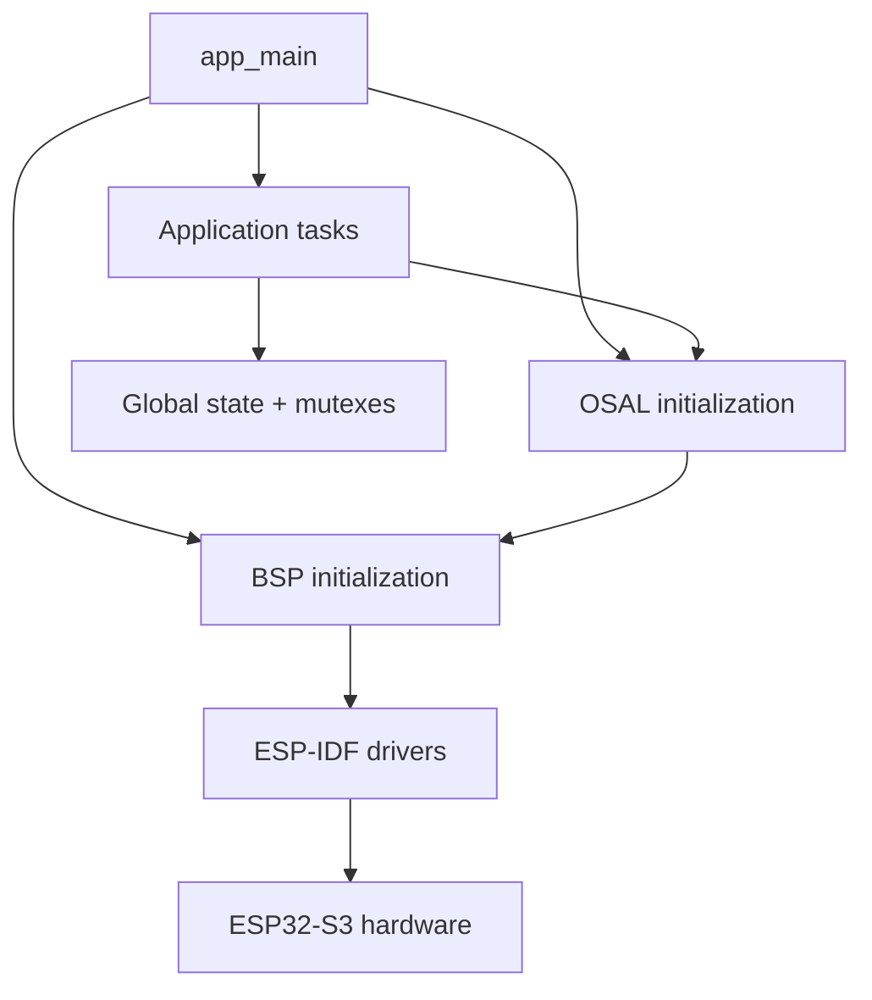
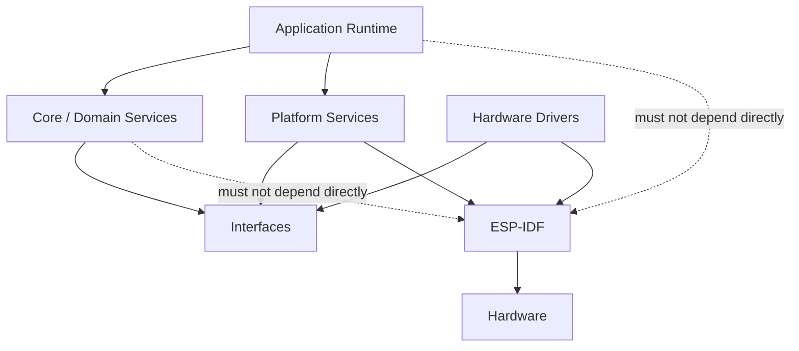
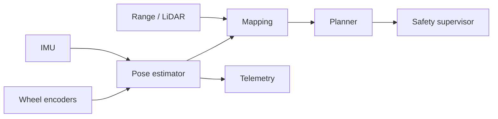

# Architecture

## Purpose

This document defines the architectural baseline for the `remote_control_car` refactor. It describes the repository as it exists today, the dependency problems that should be removed, and the target structure that future pull requests should move toward.

The baseline deliberately does **not** change runtime behavior. The goal is to make later code changes reviewable and to keep hardware, operating-system, transport, and vehicle-control concerns separate.

## Current system

The project contains four executable areas:

1. `remote_car/` — ESP32-S3 vehicle firmware.
2. `remote_car_user_control/` — ESP32 handheld controller firmware.
3. `remote_car_logs_server/` — host-side UDP log receiver.
4. `remote_car_visualization_server/` — FastAPI/WebSocket backend plus Three.js frontend.

The vehicle firmware currently uses a BSP/OSAL/APP directory split.

### Current vehicle flow



The current separation is useful, but several dependencies cross layer boundaries:

- `osal.h` exposes BSP types such as `bsp_mpu6050_angle` and MQTT types.
- `app_main()` directly knows most BSP modules and creates all application tasks.
- Network services such as MQTT, Wi-Fi, SNTP, HTTP, OTA, and NVS are grouped under `bsp/` even though they are platform services rather than board drivers.
- Application state is stored in shared global structures protected by multiple mutexes.
- Motor-control application logic calls direction-specific OSAL/BSP functions instead of sending a single actuator command.
- Driver initialization frequently uses `ESP_ERROR_CHECK`, making a peripheral initialization failure capable of aborting the whole firmware.
- The vehicle firmware is built as one large IDF component using recursive source globbing, so module dependencies are not enforced by the build system.

These points are migration targets, not criticisms of the original prototype. The existing structure allowed the project to grow quickly; the refactor now makes the boundaries explicit.

## Target dependency model

The target direction is:



### 1. Board configuration

Owns board-specific constants only:

- GPIO assignments
- hardware revision
- I2C/UART instance selection
- motor-channel mapping
- feature availability

Board configuration should not contain application behavior.

### 2. Hardware drivers

Small modules that own one physical device or peripheral abstraction:

- motor driver / MCPWM
- MPU6050
- future wheel encoders
- future distance/LiDAR sensor
- battery/current monitor

Driver APIs return status codes and data. They do not decide vehicle behavior.

Example direction:

```c
esp_err_t imu_init(imu_handle_t *handle);
esp_err_t imu_read(imu_handle_t *handle, imu_sample_t *sample);

esp_err_t motor_driver_init(motor_driver_t *driver);
esp_err_t motor_driver_apply(motor_driver_t *driver,
                             const motor_output_t *output);
esp_err_t motor_driver_stop(motor_driver_t *driver);
```

### 3. Platform services

Own ESP-IDF facilities that are not physical board drivers:

- Wi-Fi
- MQTT
- OTA
- NVS
- SNTP/time
- HTTP/WebSocket/UDP transport
- logging

Application modules consume service APIs rather than the raw ESP-IDF client handles.

### 4. Core / domain logic

Contains logic that should be testable without ESP-IDF hardware:

- command validation
- drive/motion model
- heading controller
- pose estimation
- safety supervisor
- future odometry
- mapping
- path planning

The core layer should use plain C data structures and explicit inputs/outputs.

### 5. Application runtime

Owns:

- startup order
- task creation
- queues/events
- service composition
- lifecycle/state transitions

The final `app_main()` should become a thin composition entry point.

Example target:

```c
void app_main(void)
{
    system_config_t config = system_config_default();

    ESP_ERROR_CHECK(system_init(&config));
    ESP_ERROR_CHECK(system_start());

    vTaskDelete(NULL);
}
```

The exact API can change during implementation; the architectural requirement is that task and subsystem ownership is centralized.

## Command path

The target control path is:


A transport packet must not directly manipulate PWM.

The command model should eventually be represented as one coherent message rather than separate unsynchronized direction and speed updates.

Example:

```c
typedef struct
{
    car_direction_t direction;
    uint8_t speed_percent;
    uint32_t sequence;
    int64_t received_at_us;
} vehicle_command_t;
```

## Sensor and localization path

The target data path is:



The current MPU6050 complementary filter is the starting implementation. Future odometry/localization should extend this pipeline rather than adding sensor logic directly into motor-control tasks.

## Safety ownership

Safety must be independent from manual or autonomous command generation.

```text
manual command ─┐
autonomous plan ├─> desired motion ─> SAFETY ─> motor output
failsafe state ─┘
```

The safety layer is the final authority before motor output. Future autonomous or ML code must never write PWM directly.

Potential safety inputs include:

- command timeout
- communication loss
- obstacle distance
- battery state
- excessive tilt
- driver/peripheral fault state

## Concurrency policy

Preferred communication between tasks:

1. Queue / overwrite queue for latest commands.
2. Event groups or task notifications for state transitions.
3. Immutable snapshots for telemetry.
4. Mutexes only when shared mutable state is unavoidable.

Long blocking operations must not run while holding a motor-control or sensor mutex.

Motor and safety tasks should have deterministic periods. Mapping, telemetry, logging, and visualization can run at lower rates.

## Error-handling policy

Low-level modules should return errors instead of resetting unrelated subsystems.

Preferred:

```c
esp_err_t err = imu_read(&imu, &sample);
if (err != ESP_OK) {
    diagnostics_report(DIAG_IMU_READ_FAILED, err);
    return;
}
```

Use `ESP_ERROR_CHECK` primarily for conditions that truly make the entire firmware unable to continue safely.

This is especially important for optional or recoverable devices such as the IMU, network services, visualization links, and future ranging sensors.

## Build-system direction

The current vehicle build recursively globs BSP, OSAL, APP, and `src/` into one component.

The target is separate ESP-IDF components with explicit `REQUIRES` / `PRIV_REQUIRES` relationships. This makes forbidden dependencies visible during compilation.

A possible final shape is:

```text
firmware/
├── main/
├── components/
│   ├── board/
│   ├── drivers/
│   ├── platform/
│   ├── core/
│   ├── runtime/
│   └── diagnostics/
└── tests/
```

This structure is a target, not a requirement to rename everything in one pull request. Migration should be incremental.

## Pull-request migration rules

Each architectural PR should:

- have one primary responsibility
- keep behavior changes explicit
- preserve buildability
- avoid unrelated formatting churn
- document public API changes
- add tests where the extracted logic can run without hardware
- keep `master` usable between migrations

Large directory renames should happen only when the new component boundaries are already defined, so history remains reviewable.
